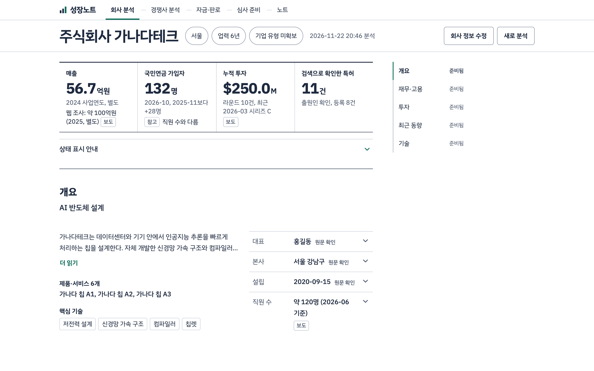

# 성장노트


회사 이름 하나로 공공 자료와 공개 보도를 모아 우리 회사를 객관적으로 분석하고, 그 분석을 근거로 받을 수 있는 자금, 심사 준비, 판로까지 연결하는 웹 서비스입니다. 라이너 해커톤(.EXE-THON) 출품작입니다.



*회사 분석 화면. 가상 회사 '가나다테크'의 합성 데이터로 찍었습니다.*

## 1. 문제

자금이 필요한 중소·벤처기업의 대표와 재무 담당자는 지원사업이나 투자 유치에 앞서 회사 현황부터 정리해야 합니다. 그러나 재무, 고용, 투자 이력, 특허, 최근 기사는 기관과 사이트마다 흩어져 있고, 자료끼리 값이 다른 경우도 적지 않습니다.

현황을 정리한 뒤에도 할 일이 남습니다. 맞는 정책자금 공고와 운용사를 찾고, 공고문을 읽어 자격을 확인하고, 판로를 찾는 일을 각각 따로 해야 합니다. 공고 목록만으로는 자격을 판단할 수 없고, 판단의 근거도 공고문에서 다시 찾아야 합니다.

## 2. 해결

성장노트는 이 과정을 회사 이름 하나에서 시작하는 한 흐름으로 연결합니다.

| 단계 | 하는 일 |
|---|---|
| 회사 분석 | 공공 API와 Liner로 개요, 재무·고용, 투자, 최근 동향, 기술(특허)을 동시에 조사하고 값마다 확인 상태와 출처를 표시합니다 |
| 경쟁사 분석 | 비교 대상(최대 5곳)의 재무·고용·투자·특허를 우리 회사와 같은 항목으로 나란히 비교합니다 |
| 자금·판로 | 분석 값으로 조건을 채워 정책자금 공고, 모태펀드 운용사, 나라장터 입찰공고와 판로 지원사업을 거릅니다 |
| 심사 준비 | 공고문과 회사 정보를 조건별로 대조하고, 운용사를 요약하고, 투자 미팅 예상 질문 19개와 실사 대비 자료 26개를 제공합니다 |
| 노트 | 결과를 한 장으로 모아 인쇄하거나 파일로 공유합니다 |

## 3. 해결 방법

- **검색은 Liner, 판단은 모델, 확인은 코드.** 코드가 Liner로 검색하고 그 결과만 모델에 전달합니다. 모델에는 검색 도구를 주지 않습니다. 공고문 자격 조건, 운용사 사실, 투자 이력 웹 보완은 코드가 근거 문장을 원문과 다시 대조해 원문에 없는 근거를 버립니다. 원문 확인 사실은 웹 원문에서 값을 찾은 경우에만 "원문 확인"을 붙이고, 나머지 값은 보도·추정으로 둡니다.
- **값마다 상태와 출처를 따로 표시합니다.** 상태는 원문 확인 · 보도 · 추정 · 엇갈림 · 미확보 · 참고이고, 출처는 기관·자료 이름과 기준일입니다. 자료끼리 값이 다르면 하나를 고르지 않고 두 값을 모두 보여 줍니다.
- **점수와 선정 확률을 만들지 않습니다.** 공고문 대조는 조건마다 충족 · 미충족 · 확인 필요와 근거 문장으로 답합니다. 이미 투자한 운용사는 신규 후보로 권하지 않습니다.
- **공공 API를 먼저 씁니다.** 법인·재무·고용·입찰·지원사업 정보는 공공 API(금융위원회 기업기본정보·요약재무제표, 국민연금공단 사업장 가입자, 조달청 나라장터, 기업마당, 한국벤처투자)와 공개 자료(NAVER 뉴스, OpenAlex, Google Patents)로 받고, 여기에 없는 사업 내용·투자 라운드·특허 후보·영문 기사·운용사 정보를 Liner로 보완합니다.
- **비용을 통제합니다.** 비용이 큰 호출은 사용자가 단추를 누를 때만 보내고, 단락별·API별 하루 상한을 두며, 한 번 분석한 회사는 저장해 다시 호출하지 않습니다.

## 4. Liner API를 사용한 기능

Liner API 5종(웹 검색, Premium 검색, 학술 검색, 모델 게이트웨이, Responses)과 모델 3종(`openai/gpt-6.2-sol`, `anthropic/claude-opus-5.5`, `liner-gpt-router`)을 9개 기능에서 사용합니다. 기본 분석은 7개 단락(그중 Liner를 쓰는 단락 5개)을 가능한 범위에서 동시에 실행하며, 실측 1회에 **Liner 19회(웹 검색 11 · Premium 2 · 모델 6), 약 2~3분**이 걸렸습니다(단락별 상한 합계 21회, 재시도 제외). 시간과 비용은 실행할 때마다 달라질 수 있습니다(`docs/verification.md`).

| 기능 | Liner API · 요청 수 | 하는 일 | 실측 |
|---|---|---|---|
| 회사 개요 | 웹 검색 3 → gpt-6.2-sol 1 | 사업·제품·핵심 기술·경쟁사 후보·기술 낱말을 정리합니다. 기술 낱말은 판로(나라장터) 검색어로 이어집니다 | 약 10초 |
| 원문 확인 사실 | 웹 검색 4 → Responses(`liner-gpt-router`) 4 | 회사 정보·인력과 투자·기존 투자자·경쟁사 4개 주제로 검색하고 웹 원문을 최대 8쪽 읽어 매출·직원 수·기존 투자자 등을 추출합니다. 원문에서 값을 찾은 것만 "원문 확인"으로 표시합니다 | 약 176초 |
| 투자 이력 | Premium 2(+ 부족 시 웹 검색 1 → 모델 1) | People Data Labs 회사 카드로 라운드·누적 투자·투자기관을 받고, 비어 있는 라운드만 웹 검색으로 보완합니다 | 30초 이내 |
| 최근 동향 | 웹 검색 최대 2(국문·영문, 최근 1년) → 모델 1 | NAVER 뉴스에 없는 기사와 영문 보도를 보완하고, 묶어서 중요 사건을 요약합니다(사건마다 근거 기사) | 30초 이내 |
| 기술 · 특허 | 웹 검색 2(`site:patents.google.com`) | 특허 후보를 찾은 뒤 Google Patents 원문에서 출원인이 해당 회사인 특허만 셉니다(회사당 원문 30쪽) | 30초 이내 |
| 논문 동향(요청 시) | 학술 검색 기술 분야당 1(최대 6, 재시도 포함 최대 12) → 모델 1 | OpenAlex와 함께 연도별 발표량·주요 기관·주요 논문을 정리합니다 | 26.5초 |
| 경쟁사 깊이 비교(요청 시) | 경쟁사 1곳당 웹 검색 2~3 · Premium 1~2, 비교 전체에 모델 1~2(상한: 5곳 34, 재시도 제외) | 경쟁사마다 특허·투자를 Liner로 찾아(최근 기사는 NAVER) 우리 회사와 같은 항목으로 비교하고, 경쟁사별 사업·최근 변화를 요약합니다 | 2곳 31.6초, 11회 |
| 공고문 자격 대조(요청 시) | gpt-6.2-sol 1(조건 추출) → claude-opus-5.5 1(대조) | 공고문에서 자격 조건을 추출하고 회사 정보와 조건별로 대조합니다. 추출 결과는 공고마다 저장해 모든 회사가 재사용합니다 | 26~30초 |
| 운용사 요약(요청 시) | 웹 검색 1 → 모델 1 | 담은 운용사의 투자 분야·단계·사례·펀드 결성·제안 경로를 검색 결과에 적힌 사실로만 정리합니다 | 5~7초 |

- **모델 결과를 코드로 검증합니다.** 공고문 조건(6자 이상, 공고문 원문에 글자 그대로), 운용사 사실과 투자 이력 보완(검색 결과 발췌)은 근거 문장이 원문에 없으면 버립니다. 특허는 Google Patents 원문의 출원인을 확인하고, 원문 확인 사실은 웹 원문에서 값을 찾은 것만 "원문 확인"으로 표시합니다(찾지 못한 값은 보도·추정으로 남깁니다). 개요·최근 동향·논문·경쟁사 요약처럼 모델이 여러 자료를 정리한 글은 글자 단위 원문 대조를 하지 않습니다. 공고문 조건 추출에서는 근거 문장 48개가 모두 원문에서 확인됐습니다(공고 3건, 2026-11-21).
- **모델도 Liner로 부릅니다.** 공고문 조건 추출은 gpt-6.2-sol, 회사 정보와의 대조는 claude-opus-5.5를 Liner 모델 게이트웨이로 부릅니다. 모든 모델 호출이 같은 Liner 클라이언트(`liner_client.py`)를 거치므로, 모델 이름만 바꾸면 다른 모델로 바꿀 수 있습니다.
- **호출을 통제합니다.** 웹 검색은 `include_knowledge=false`를 명시해 보냅니다. 단락별 상한(기본 분석 합계 21회), API별 하루 상한(웹 검색 500 · Premium 100 · 모델 200 · 학술 200), 동시 요청 상한(웹 검색 4 · Premium 3 · 모델 3 · 학술 4)을 둡니다. 개요·투자 이력·최근 동향·특허·논문·경쟁사 비교의 Liner 요청은 같은 요청이면 24시간 동안 저장된 결과를 다시 쓰고, 공고문 조건 추출은 공고마다 저장해 다시 씁니다. 원문 확인 사실과 운용사 요약은 매번 새로 요청합니다(한 번 끝난 회사 분석은 서버에 저장해 다시 부르지 않습니다). 524·429·5xx 응답은 `Retry-After`에 따라 1회만 재시도하며, 재시도가 생기면 실제 요청 수는 상한의 최대 2배가 될 수 있습니다(하루 상한은 이를 감안해 미리 잡습니다).
- **외부 문서는 데이터로만 다룹니다.** 검색 결과와 원문 안의 지시문은 따르지 않도록 모델 지시문에 명시했습니다.

## 5. 설치와 실행

필요한 것: Python 3.12, Node.js 24 이상과 npm(확인한 버전 24.15, 화면 테스트가 TypeScript 파일을 Node로 바로 읽습니다), bash(macOS·Linux).

```bash
python3.12 -m venv .venv
.venv/bin/pip install -r requirements.txt
cp .env.example .env        # 키를 입력합니다. .env 는 커밋하지 않습니다
scripts/run_local.sh        # 화면 빌드 후 분석 서버(8000)와 화면(3100)을 함께 띄웁니다
```

브라우저에서 `http://127.0.0.1:3100`을 열고 회사 이름을 입력합니다. 종료는 `Ctrl+C`입니다. 처음 실행할 때 `web/node_modules`가 없으면 `npm install`과 화면 빌드를 함께 진행합니다.

| `.env` 키 | 필요 | 발급처 | 없을 때 |
|---|---|---|---|
| `LINER_API_KEY` | 필수 | [Liner Platform](https://platform.liner.com) | Liner를 쓰는 분석·공고문 대조·운용사 요약을 사용할 수 없습니다 |
| `DATA_GO_KR_SERVICE_KEY` | 권장 | [공공데이터포털](https://www.data.go.kr) 일반 인증키. 키 하나로 함께 쓰며 API마다 활용신청이 필요합니다: 금융위원회 기업기본정보(`GetCorpBasicInfoService_V2`)·기업재무정보(`GetFinaStatInfoService_V2`), 국민연금 사업장 가입자(`NpsBplcInfoInqireServiceV2`), 조달청 나라장터 입찰공고(`BidPublicInfoService02`) | 법인 조회를 할 수 없어 공식 재무·고용·나라장터가 "미확보"로 표시됩니다. 시작 화면의 "공개 자료만으로 분석"으로 나머지 분석을 진행합니다 |
| `NAVER_CLIENT_ID`, `NAVER_CLIENT_SECRET` | 권장 | [NAVER Developers](https://developers.naver.com) 애플리케이션 등록(검색 API) | 최근 동향 단락이 "미확보"로 표시됩니다(Liner 웹 검색은 NAVER 뉴스를 보완하는 용도입니다) |
| `OPENALEX_API_KEY` | 선택 | [OpenAlex](https://openalex.org) | 키 없이 공개 API로 동작합니다 |
| `BIZINFO_API_KEY`, `KVIC_API_KEY` | 선택 | [기업마당](https://www.bizinfo.go.kr), [한국벤처투자](https://www.kvic.or.kr) | 실행에는 필요 없습니다. 기업마당 지원사업·한국벤처투자 펀드 목록은 저장소의 스냅샷(`web/public/data/`)을 쓰며, 스냅샷을 새로 받을 때([`scripts/fetch_public_data.py`](scripts/fetch_public_data.py), `.venv/bin/python scripts/fetch_public_data.py`로 실행)만 필요합니다 |
| `GROWTH_EXAMPLE_COMPANY_ID` | 선택 | 발급 없음(키가 아니라 이 서비스에서 분석을 마친 회사의 id. 회사 분석 주소 `/c/<id>`의 값 그대로이며, 법인등록번호 13자리 또는 법인 없이 분석한 회사는 `n-`과 16자) | 시작 화면에 "예시 회사로 보기"가 나오지 않습니다. 값을 넣으려면 그 회사의 분석 결과가 서버(`results/analysis/`)에 저장돼 있어야 합니다. 지정한 회사는 신규 분석이 제한됩니다 |

키가 비어 있으면 해당 API를 쓰는 단락만 "미확보"로 표시하고 나머지 분석은 계속합니다. 키는 서버에만 두며 화면·로그·결과 파일에 남기지 않습니다. 회사 없이 공고와 운용사만 보려면 시작 화면의 "회사 없이 자금만 둘러보기"를 사용합니다(키가 필요 없습니다).

테스트(외부 연결 없이 가짜 응답으로 실행):

```bash
.venv/bin/python -m pytest -q tests
npm --prefix web test
```

## 6. 향후 발전 계획

- **한 번 분석해 여러 번 활용**: 회사 분석과 공고문 추출 결과를 저장해 여러 사용자가 다시 사용합니다. 비용은 사용자 수보다 회사 수에 좌우됩니다.
- **지원 분야 확대**: 공고문에서 조건을 추출해 대조하는 구조를 기술(222건)·수출(138건)·인력(155건) 지원사업으로 넓힙니다(저장소에 든 기업마당 지원사업 스냅샷의 분야별 공고 수, 수시·접수 예정 포함, 2026-11-21 기준).
- **기능 보완**: 조건에 맞는 새 공고 알림, 세부 자금이 여러 개인 공고의 2단계 추출, 표가 많은 공고문의 표 구조 보존, 운용사 제안 창구 안내.
- **활용 주체 확대**: 자금을 찾는 기업에 더해 지원기관·액셀러레이터, 여신·투자 담당자의 사전 검토에 사용합니다.
- **운영 기반**: 클라우드 배포와 사용자 인증을 도입하고 비용 보호를 강화합니다.

## 더 보기

- 설계: `docs/integration-design.md`, 화면 설계: `docs/ux/`, 서버·화면 데이터 계약: `docs/contract.md`
- 실제 서버 검증 기록: `docs/verification.md`, 공고문 분석 실측: `docs/notice-analysis-results.md`
- 해커톤 기간에 만든 순서와 알려진 한계: `docs/scope-and-limits.md`
- 시연 서버 운영(macOS launchd): `docs/operations.md`
- 제출 자료: `docs/submission/`
