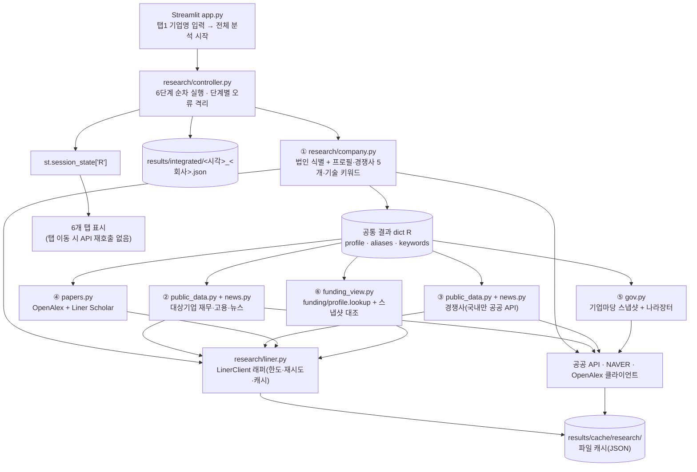

# Liner Research Agent

기업명을 하나 입력하면 기업 기초정보, 재무·고용·뉴스, 경쟁사, 기술동향, 정부지원사업·입찰공고, 펀딩 정보를 한 번에 수집·분석하는 서비스입니다. Liner API(웹 검색·모델·학술 검색)와 공공 API(금융위원회, 국민연금, 나라장터 등), NAVER 뉴스, OpenAlex를 함께 사용합니다.

> **현재 상태: 통합 분석 로직의 프로토타입 단계입니다.** 대규모 DB, 정기 수집 서버, 사용자 인증, 클라우드 배포는 없습니다.

---

## 1. 현재 구현 범위

### 통합 기업분석 UI = Streamlit (`app.py`)

**현재 통합 기업분석의 사용자 화면은 Streamlit으로만 구현되어 있습니다.** 탭은 6개입니다.

| 탭 | 표시 내용 |
|---|---|
| 1. 기업 검색 | 기업명 입력과 **전체 분석 시작** 버튼, 6단계 진행률, 기업 기본정보(정확한 상호·영문명·사업자/법인등록번호·설립일·대표자·업종·주소), 주요 사업, 제품·서비스, 핵심 기술, 경쟁사 5개, 기술 키워드 |
| 2. 기업 세부정보 | 최근 3개 사업연도 재무(표·그래프), 국민연금 가입자 12개월 추이(신규 취득·상실·증가율), 최근 12개월 뉴스 목록(분류 필터·중복 정리), Liner 기반 동향 요약과 중요 사건 |
| 3. 경쟁사 동향 | 대상기업과 경쟁사의 재무·고용 비교 표와 그래프, 경쟁사별 사업·제품·최근 변화 요약, 재무·고용·뉴스 |
| 4. 기술동향 | 기술 분야별 연도별 논문 수 그래프와 증감 추세, 주요 연구기관, 논문 목록(제목·저자·연도·초록·링크), 연구 흐름과 대상기업 기술과의 관련성 요약, **경쟁사·대상기업이 저자 소속으로 직접 참여한 논문** 별도 표 |
| 5. 정부사업·입찰공고 | 기업마당 지원사업과 나라장터 입찰공고를 한 목록으로 통합(중복은 한 건으로), 모집·입찰 진행 중 → 관련성 → 마감 임박 순으로 정렬, 구분·상태·관련성 필터 |
| 6. 펀딩 | 펀딩노트 회사 조회 결과(기존 투자자, 경쟁사 투자 이력), 모태펀드 자펀드 운용사 후보(기존 투자자 제외), 정책융자·보증 후보 |

**동작 방식**
1. 첫 번째 탭에서 기업명을 입력하고 **전체 분석 시작**을 누릅니다(분석 버튼은 이 하나뿐입니다).
2. 6단계가 순서대로 실행되고, 화면에 진행 문구("경쟁사 5개 선정 완료", "국민연금 가입자 수집 완료", "나라장터 입찰공고 검색 중..." 등)와 진행률, 단계별 완료·실패가 표시됩니다.
3. 완료되면 결과가 `st.session_state`에 보관되어 6개 탭에서 열람할 수 있습니다. **탭을 이동해도 API를 다시 호출하지 않습니다.**
4. 일부 API가 실패하면 그 항목만 "자료 확보 불가"로 표시하고 나머지 분석은 계속합니다. 실패 사유는 첫 탭의 "미확보·오류" 펼치기에 모입니다.

기준 기업 기준 실제 실행 시간은 약 5분입니다. 그중 펀딩노트 회사 조회가 가장 오래 걸립니다(약 2~3분).

### 함께 있는 다른 구성요소 (통합 UI가 아님)

| 구성 | 실제 역할 | 통합 Streamlit 과의 관계 |
|---|---|---|
| `api/main.py` (FastAPI) | 펀딩노트 웹 화면용 분석 서버. 공고문 자격 대조, 회사 조회(비동기 작업), 운용사 요약 엔드포인트 | **Streamlit 통합 분석에는 필요 없습니다.** Streamlit 은 같은 Python 모듈(`funding/`)을 직접 호출합니다 |
| `web/` (Next.js, 펀딩노트) | 중소·벤처기업 자금 찾기 웹 화면(라이너 해커톤 출품작) | **통합 기업분석 UI가 아니며 이번 Streamlit 통합 대상에서 제외했습니다.** 6개 탭 분석 기능은 웹 화면에 없습니다 |
| `app_legacy.py` | 이전 Streamlit 화면(8개 탭, Liner API 정보 수집 성능 검증용) | 별도 실행. 통합 분석과 독립 |

---

## 2. 설치 및 실행 (Ubuntu)

Python 3.12에서 개발·검증했습니다.

```bash
# 1) 저장소 클론 (통합 분석은 이 브랜치에 있습니다)
git clone https://github.com/walkbyhankang/liner-research-agent.git
cd liner-research-agent
git checkout feature/streamlit-integrated-research

# 2) 가상환경과 의존성
python3.12 -m venv .venv
.venv/bin/pip install -r requirements.txt

# 3) API 키 설정
cp .env.example .env
#    .env 를 열어 자신의 키를 입력합니다(각 키의 용도·필수 여부는 .env.example 주석 참고).
#    .env 는 .gitignore 로 제외되어 있습니다. 절대 커밋하지 마세요.

# 4) Streamlit 실행
.venv/bin/python -m streamlit run app.py
#    또는 실행 스크립트(패키지 누락 확인 후 127.0.0.1:8501 로 띄움)
scripts/run_local.sh streamlit
```

- 브라우저에서 `http://localhost:8501` 에 접속합니다(스크립트 사용 시 `http://127.0.0.1:8501`, 포트는 `STREAMLIT_PORT` 로 변경).
- 종료: 실행한 터미널에서 `Ctrl+C`.
- FastAPI 서버는 Streamlit 통합 분석에 필요하지 않습니다.

### 테스트
```bash
.venv/bin/python -m pytest -q tests   # 실제 API 를 호출하지 않습니다(httpx.MockTransport·monkeypatch 사용)
```

### (참고) 펀딩노트 웹 화면과 이전 화면
```bash
scripts/run_local.sh fundingnote          # 펀딩노트 화면 3100 + FastAPI 8000 (Node.js 필요)
scripts/run_local.sh                      # 펀딩노트와 Streamlit 을 함께
.venv/bin/python -m streamlit run app_legacy.py   # 이전 8탭 검증 화면
```

---

## 3. 사용하는 API

### 통합 분석(Streamlit 6개 탭)에서 실제로 호출하는 API

| API | 사용 목적 | 사용하는 분석 기능(탭) | 환경변수 |
|---|---|---|---|
| Liner Web Search (`/api/v1/tools/search/web`) | 기업 개요·제품·경쟁사 자료 검색, 뉴스 보완 검색 | ① 프로필·경쟁사, ② ③ 뉴스, ⑥ 펀딩노트 회사 조회 | `LINER_API_KEY` |
| Liner Model (게이트웨이 Chat Completions, `openai/gpt-6.2-sol`) | 검색 자료를 JSON 으로 정리: 프로필·경쟁사 5개·기술 키워드·검색어 도출, 뉴스 중요 사건 요약, 경쟁사 요약, 논문 요약 | ① ② ③ ④ ⑥ | `LINER_API_KEY` |
| Liner Scholar (`/api/v1/tools/search/scholar`) | 기술 분야별 추가 논문 검색 | ④ 기술동향 | `LINER_API_KEY` |
| 금융위원회 기업기본정보 (`GetCorpBasicInfoService_V2`) | 법인 식별(상호·영문명·법인/사업자등록번호·설립일·대표자·주소) | ① ② ③ | `DATA_GO_KR_SERVICE_KEY` |
| 금융위원회 기업재무정보 (`GetFinaStatInfoService_V2` 요약재무제표) | 매출·영업이익·순이익·자산·부채·자본 등 연도별 재무 | ② ③ | `DATA_GO_KR_SERVICE_KEY` |
| 국민연금 사업장 가입자 (`NpsBplcInfoInqireServiceV2`) | 월별 가입자 수, 신규 취득·상실 인원 | ② ③ | `DATA_GO_KR_SERVICE_KEY` |
| 나라장터 입찰공고 (`BidPublicInfoService02`, 물품·용역) | 기술 관련 공고명 검색, 금액·입찰기간·발주기관 | ⑤ | `DATA_GO_KR_SERVICE_KEY` |
| NAVER 검색 API (뉴스) | 최근 12개월 기업·경쟁사 뉴스 수집(날짜순·정확도순·주제별) | ② ③ | `NAVER_CLIENT_ID`, `NAVER_CLIENT_SECRET` |
| OpenAlex (`/works`, `/institutions`) | 연도별 논문 발표량, 주요 연구기관, 논문 메타데이터·초록, 기업 소속 논문 | ④ | `OPENALEX_API_KEY`(선택) |

### 직접 호출하지 않고 저장된 스냅샷을 읽는 API

| API | 사용 목적 | 사용하는 분석 기능 | 환경변수 |
|---|---|---|---|
| 기업마당 지원사업정보 | 정부지원사업 공고, 정책융자·보증 후보 | ⑤, ⑥ | `BIZINFO_API_KEY`(스냅샷 재생성 시에만) |
| 한국벤처투자 펀드현황(모태펀드 자펀드) | VC(운용사) 후보 | ⑥ | `KVIC_API_KEY`(스냅샷 재생성 시에만) |

스냅샷은 `web/public/data/programs.json`, `funds.json`, `meta.json` 이며 `scripts/fetch_public_data.py` 로 새로 받습니다. 펀딩노트 웹 화면과 같은 파일을 씁니다.

### 통합 분석에서 쓰지 않는 Liner 기능
Search Agent, Premium Data(`include_knowledge=true`)는 `app_legacy.py`(이전 검증 화면)에서만 씁니다. Deep Research 는 어디에서도 호출하지 않습니다.

---

## 4. 시스템 아키텍처



**실행 과정**
1. **Streamlit UI**(`app.py`)가 `controller.run(기업명)`을 호출하고 진행 문구·단계 완료 콜백을 화면에 표시합니다.
2. **통합 분석 컨트롤러**(`research/controller.py`)가 6단계를 순서대로 실행합니다. 단계마다 예외를 잡아 오류를 기록하고 다음 단계로 넘어갑니다.
3. **기업 식별·공통 프로필**(①): 금융위 기업기본정보로 법인을 찾고, Liner 웹 검색 3회 결과를 모델 1회로 정리해 사업·제품·핵심 기술·경쟁사 5개·기술 키워드·정부사업/나라장터 검색어를 만듭니다. 이 결과를 이후 모든 단계가 재사용합니다.
4. **외부 API 클라이언트·수집·정규화**(②~⑤): 재무는 연도별로 정리(같은 연도에 연결·별도가 있으면 연결)하고, 뉴스는 같은 사건 기사를 묶고 주제를 분류합니다. 논문은 제목 기준으로 중복을 제거하고, 공고는 제목 기준으로 소스 간 통합합니다.
5. **Liner 기반 분석**: 기사·논문을 하나씩 보내지 않고 목록을 묶어 모델 1회씩(뉴스 요약, 경쟁사 요약, 논문 요약) 호출합니다.
6. **펀딩**(⑥): 펀딩노트의 회사 조회(`funding/profile.lookup`)를 그대로 호출하고, 펀딩노트 화면(`web/lib/finder.ts`)의 운용사·정책상품 대조 규칙을 Python 으로 옮겨 적용합니다. ①의 지역·기업 단계·관심 투자 분야를 입력값으로 씁니다.
7. **저장·캐시**: 외부 API 응답은 `results/cache/research/` 에 파일 캐시(Liner 24시간, 공공 API 24시간, 뉴스 6시간, 나라장터 12시간, OpenAlex 72시간)로 저장해 같은 요청을 다시 보내지 않습니다. 최종 결과는 키를 지운(`analysis.scrub`) 뒤 `results/integrated/` 에 JSON 으로 저장합니다. 별도 DB 는 없습니다.
8. **6개 탭 표시**: `st.session_state` 의 결과로 표·그래프(plotly)를 그립니다.

---

## 5. 주요 모듈 및 디렉터리 구조

```
app.py                  Streamlit 진입점(6개 탭 통합 분석 UI)
research/               통합 분석 모듈(이번 브랜치 신규)
  controller.py         6단계 실행·오류 격리·결과 저장
  company.py            ① 법인 식별 + 기업 프로필·경쟁사·기술 키워드(Liner)
  public_data.py        금융위 기업기본정보·요약재무제표, 국민연금 가입자(재무·고용, 대상기업·경쟁사 공통)
  news.py               NAVER 뉴스 + Liner 보완 검색, 중복 정리, 주제 분류, 동향 요약
  papers.py             OpenAlex 발표량·기관·논문, Liner Scholar, 기업 소속 논문, 논문 요약
  gov.py                기업마당 스냅샷 대조, 나라장터 입찰공고(7일 구간 분할), 통합·정렬
  funding_view.py       펀딩노트 기능 연결(회사 조회, 운용사·정책상품 대조)
  liner.py              LinerClient 래퍼(결과 캐시, 실패 시 None 반환)
  common.py             .env 키 읽기·마스킹, 파일 캐시, 이름 정규화
config.py               설정, 호출 한도, 가격표, Liner 키 탐색
liner_client.py         Liner HTTP 클라이언트(호출 종류별 한도, 524/429/5xx 1회 재시도, 호출 기록)
funding/                펀딩노트 Python 로직(회사 조회, 경쟁사 투자 이력, 공고문 대조, 운용사 요약)
api/main.py             펀딩노트용 FastAPI 서버
web/                    펀딩노트 Next.js 화면 + 공공 데이터 스냅샷(web/public/data)
scripts/                run_local.sh(실행), fetch_public_data.py(스냅샷 생성), analyze_notice.py(실험)
pipeline.py, planner.py, sources.py, fetcher.py, categories.py, integrate.py, analysis.py
                        기존 기업분석 엔진(펀딩노트 회사 조회와 app_legacy.py 가 사용)
app_legacy.py, run_probe.py   이전 Streamlit 검증 화면, CLI
tests/                  pytest(실제 API 호출 없음)
docs/                   설계·API 조사·실험 결과
results/                실행 결과·캐시(Git 제외)
```

---

## 6. 이번 브랜치(`feature/streamlit-integrated-research`)의 수정사항

`main` 대비 실제로 구현·변경한 내용입니다.

- **Streamlit 6개 탭 통합**: `app.py` 를 6개 탭 통합 분석 화면으로 교체했습니다. 이전 8탭 검증 화면은 `app_legacy.py` 로 그대로 보존했습니다.
- **첫 번째 탭의 단일 분석 실행**: 버튼 하나로 6단계 수집·분석을 순서대로 실행합니다.
- **통합 분석 파이프라인**: `research/controller.py` 가 단계 결과를 공통 dict 에 쌓고, ①의 프로필·경쟁사·기술 키워드를 ②~⑥이 재사용합니다.
- **진행상황 표시**: 진행 문구, 진행률 막대, 단계별 상태(대기/진행 중/완료/실패)와 소요 시간을 표시합니다.
- **기업 기본정보 분석**: 금융위 기업기본정보로 식별번호·설립일·대표자를 가져오고, 같은 상호 법인이 여럿이면 후보를 함께 보여줍니다. Liner 로 사업·제품·기술·경쟁사를 정리합니다.
- **재무·고용·뉴스 수집**: 금융위 요약재무제표 최근 3개년(매출액 증가율·영업이익률은 표의 값으로만 계산), 국민연금 12개월(사업자번호 앞 6자리로 법인 대조), NAVER 뉴스 12개월(같은 사건 기사 묶기)을 수집합니다.
- **경쟁사 분석**: 대상기업과 같은 수집 모듈을 재사용합니다. 국내 기업만 공공 API 를 적용하고 해외 기업은 뉴스·요약만 수집하며, 비교 표·그래프를 제공합니다.
- **기술동향 분석**: OpenAlex 연도별 발표량·기관·논문과 Liner Scholar 추가 논문을 수집합니다. 저자 원문 소속에서 회사명을 확인한 논문만 '직접 참여'로 강조합니다.
- **정부사업·입찰공고**: 기업마당 스냅샷 키워드 대조와 나라장터 검색 결과를 통합하고 중복을 정리합니다. 관련성은 정렬·분류에만 쓰고 공고를 제외하지 않습니다.
- **기존 펀딩노트 기능 통합**: `funding/profile.lookup` 을 그대로 호출하고, 펀딩노트 화면의 대조 규칙을 그대로 옮겼습니다. 새 매칭 알고리즘은 추가하지 않았습니다.
- **API 결과 재사용·중복 호출 감소**: 파일 캐시와 `session_state` 를 씁니다. 기사·논문을 묶어 모델을 호출하고, Liner 호출 한도는 검색 30, 모델 10, 학술 12회입니다.
- **오류 격리**: 단계별 예외 처리와 API 별 실패 기록으로, 실패한 항목만 미확보로 두고 나머지 분석을 계속합니다.

**추가·변경 파일**

| 구분 | 파일 |
|---|---|
| 신규 | `research/` 10개 파일, `tests/test_research.py`(7개 테스트), `app_legacy.py` |
| 변경 | `app.py`(6개 탭 UI), `liner_client.py`(`search_scholar` 추가, `scholar` 호출 한도), `config.py`(학술 검색 경로·기본 한도 0) |
| 문서·설정 | `README.md`, `.env.example`(사용 중인 모든 키와 용도), `.gitignore`(임시파일·Streamlit 로컬 설정) |

`api/`, `web/`, `funding/`, 기존 엔진(`pipeline.py` 등)은 변경하지 않았습니다.

---

## 7. 현재 제약사항

- **결과는 외부 API 응답에 따라 달라집니다.** 같은 기업이라도 실행 시점마다 검색 결과와 모델 요약이 다를 수 있습니다.
- **재무·고용 자료가 없는 기업이 있습니다.** 금융위 재무는 제출된 연도까지만 있습니다. 예를 들어 기준 기업은 2020~2022년까지입니다. 국민연금 가입자 수는 전체 임직원 수와 같지 않습니다. 해외 기업에는 국내 공공 API 를 적용하지 않습니다.
- **API 인증키가 필요합니다.** 키가 없는 API 는 건너뛰고 부분 결과만 표시합니다(`.env.example` 참고).
- **일부 API 호출이 실패하면 부분 결과만 표시됩니다.**
- **나라장터는 최근 28일만 검색합니다.** 조회 기간이 7일을 넘으면 API 가 오류를 내서 7일 구간으로 나눠 부르기 때문입니다. 기업마당은 스냅샷에 남은 현재 모집·예정 공고만 대상이며, 지원금액은 API 에 없어 공고문 확인이 필요합니다.
- **경쟁사 선정, 기술 키워드, 기업 단계는 모델이 정리한 초안입니다.** 기업 단계는 펀딩 탭의 정책상품 대조 입력값으로 쓰입니다.
- **통합 분석 UI 는 Streamlit 뿐입니다.** 펀딩노트 웹 화면(`web/`)에는 이 기능이 없습니다.
- 투자 가능성·점수는 계산하지 않습니다. 정부사업 관련성과 VC 후보 순서는 참고용 정렬입니다.
